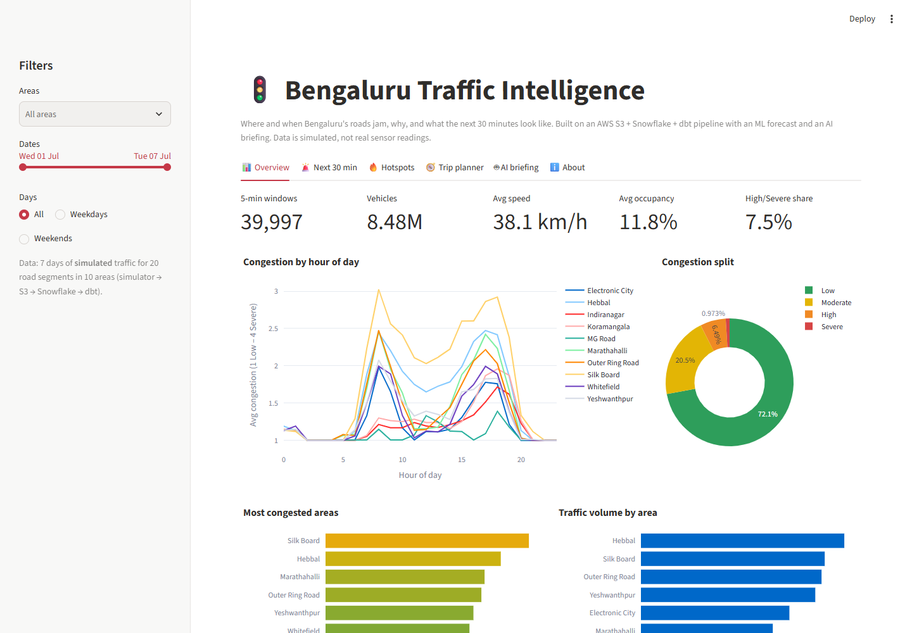
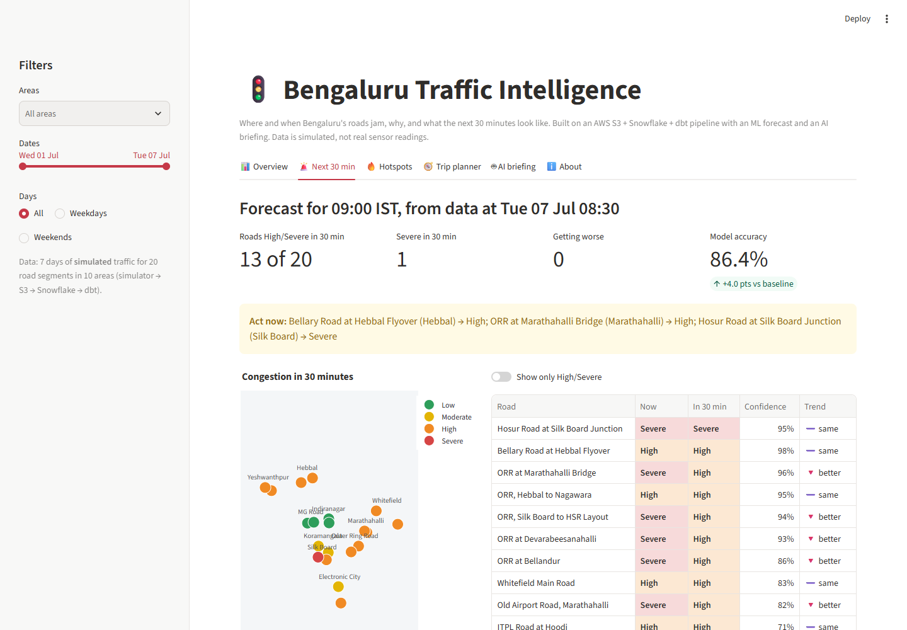
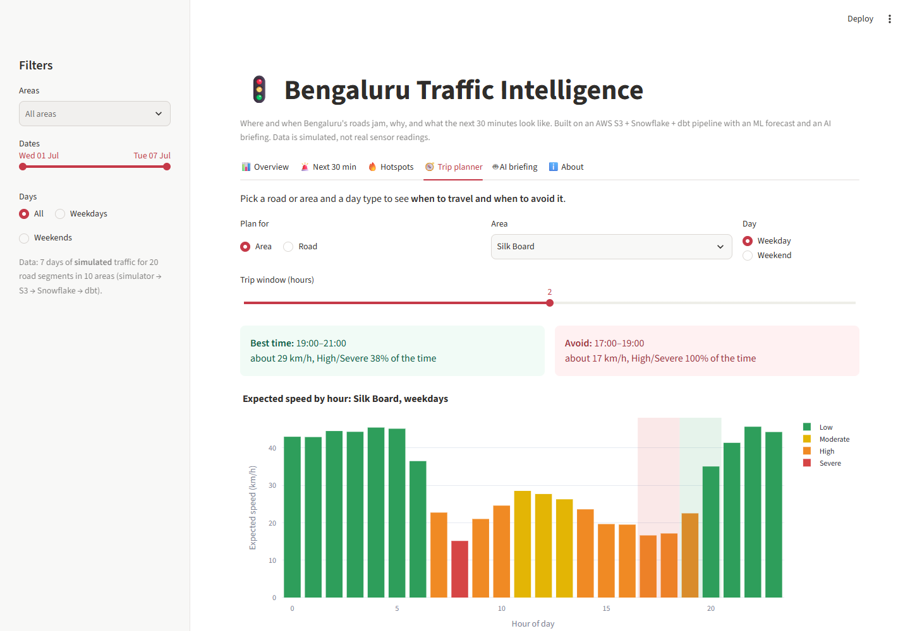
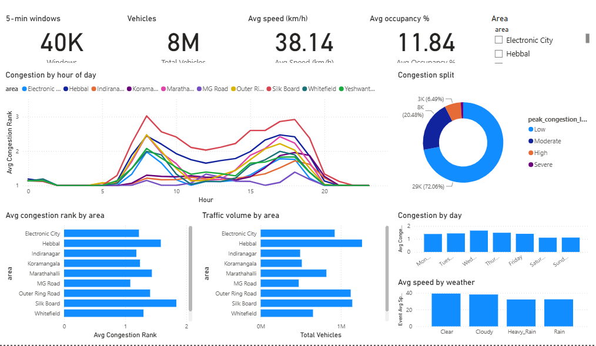
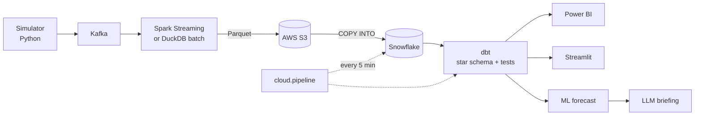

# 🚦 Bengaluru Traffic Intelligence Platform

[](https://github.com/jonna-agnes/BengaluruTrafficAnalysis/actions/workflows/ci.yml)


An end-to-end data platform that turns road-traffic readings into **dashboards, a 30-minute congestion forecast, a trip planner and AI-written traffic reports**.

### ▶ [Live app](https://bengalurutrafficanalysis-cvub6brckcyxqvj8s9arvx.streamlit.app/)



---

## ❗ Problem statement

Bengaluru's junctions, such as Silk Board, Hebbal and Marathahalli, jam every day. Traffic teams get thousands of sensor readings, but:
- the raw data is **messy**, with duplicates, missing fields and impossible values,
- it can't answer **"where, when and why"** until it's cleaned and modelled,
- teams only see congestion **after** it happens.

**Goal:** a cloud pipeline that cleans, stores and models traffic data, then shows **where and when congestion happens, why, and what the next 30 minutes look like.**

> The data comes from a built-in **traffic simulator** (`simulator/`), because real sensor feeds aren't public. It models rush hours, weekends, monsoon rain and incidents.

---

## 📊 Output

**[Live Streamlit app](https://bengalurutrafficanalysis-cvub6brckcyxqvj8s9arvx.streamlit.app/)**, with one tab per use case:

| Tab | What it gives |
|---|---|
| 📊 Overview | KPIs, rush-hour curve, congestion split, area rankings, weather and incident impact |
| 🚨 Next 30 min | Forecast alerts ("13 of 20 roads High/Severe in 30 min"), road map, per-road forecast with trend |
| 🔥 Hotspots | Area × hour heatmap and a ranked road list with each road's worst hour |
| 🧭 Trip planner | Best and worst time to travel for any area or road, weekday or weekend |
| 🤖 AI briefing | Plain-English operations report written by an LLM from the data |

**30-minute forecast:** **86.4%** accurate, against 82.4% for a "no change" baseline.


**Trip planner**


**Power BI report** (`powerbi/BengaluruTraffic.pbip`, ready to open)


**Key findings (7 days, 20 road segments):**
- **39,997** five-minute windows, **8.5M** vehicles, average speed **38.1 km/h**
- **Silk Board** is the most congested area, and **MG Road** the least. **Hebbal** carries the most traffic.
- The worst hour is **8 AM on weekdays**, with 46% of readings High/Severe. The evening peak is 5–7 PM.
- **Rain** more than triples High/Severe congestion (17.9% against 5.2% in clear weather).
- **Accidents** cut average speed to **16 km/h** and waterlogging to **23 km/h**, against 38 km/h normally.

---

## 🎯 Use cases

- **Traffic control rooms** (*Next 30 min*): see which roads will jam in 30 minutes and act first.
- **City planners** (*Hotspots*): find the roads and hours that jam every day.
- **Commuters and logistics companies** (*Trip planner*): pick the best time to travel or deliver.
- **Emergency services** (*Next 30 min*): route around roads forecast to be Severe.
- **Analysts** (*Power BI, CSV download*): explore the star schema and filtered data.

---

## 🏗️ Architecture and flow



1. **Simulate:** `simulator/` produces a reading every 5 minutes per road: vehicles, speed, occupancy, weather, incidents. Speed follows the BPR speed–flow model, and duplicate and invalid records are injected on purpose.
2. **Stream:** events go to **Kafka**, keyed by road. **Spark Structured Streaming** validates them, removes duplicates and builds 5-minute windows. `cloud/batch_load.py` does the same with **DuckDB** on a laptop.
3. **Store:** clean data lands in **Amazon S3** as Parquet (`raw/` and `aggregated/`).
4. **Load:** **Snowflake** reads S3 through a storage integration (an IAM role, no stored keys). `COPY INTO` loads only new files.
5. **Model:** **dbt** builds a star schema (staging → intermediate → marts) with 19 data tests: unique keys, valid values, relationships and physical ranges.
6. **Schedule:** `python -m cloud.pipeline --every 5` loads new files and rebuilds dbt every 5 minutes.
7. **Serve:** **Power BI** and **Streamlit** dashboards, a **scikit-learn** 30-minute forecast, and an **LLM** briefing grounded only in computed facts.
8. **CI/CD:** **GitHub Actions** tests the app on every push; **Streamlit Cloud** redeploys it automatically.

**Star schema:** `fact_traffic_5min` and `fact_traffic_events`, joined to `dim_date`, `dim_road_segment`, `dim_weather` and `dim_incident`.

---

## 🧰 Tech stack

| Layer | Tools |
|---|---|
| Language | Python, SQL |
| Streaming | Apache Kafka, PySpark Structured Streaming, Docker |
| Batch | DuckDB |
| Cloud storage | Amazon S3, AWS IAM |
| Warehouse | Snowflake |
| Transformation | dbt |
| BI and apps | Power BI, Streamlit, Plotly |
| ML and AI | scikit-learn, LLM via OpenRouter |
| Quality and CI/CD | pytest, dbt tests, GitHub Actions |

---

## 🚀 Quick start

```bash
pip install -r requirements.txt

python -m simulator                       # 1. generate 7 days of events
python -m cloud.setup all                 # 2. create S3 + IAM + Snowflake (needs .env, see .env.example)
python -m cloud.batch_load                # 3. clean + aggregate -> S3
python -m cloud.pipeline                  # 4. S3 -> Snowflake + dbt build and tests (add --every 5 to schedule)
python -m ml.train && python -m ml.predict                            # 5. forecast
streamlit run streamlit_app/app.py                                    # 6. app
```

Streaming instead of batch: `docker compose -f streaming/docker-compose.yml up -d`, then `python -m streaming.spark_job` and `python -m streaming.producer`. Tests: `python -m pytest`.

```
simulator/  streaming/  cloud/  traffic/ (dbt)  ml/  genai/  powerbi/  streamlit_app/  tests/
```
